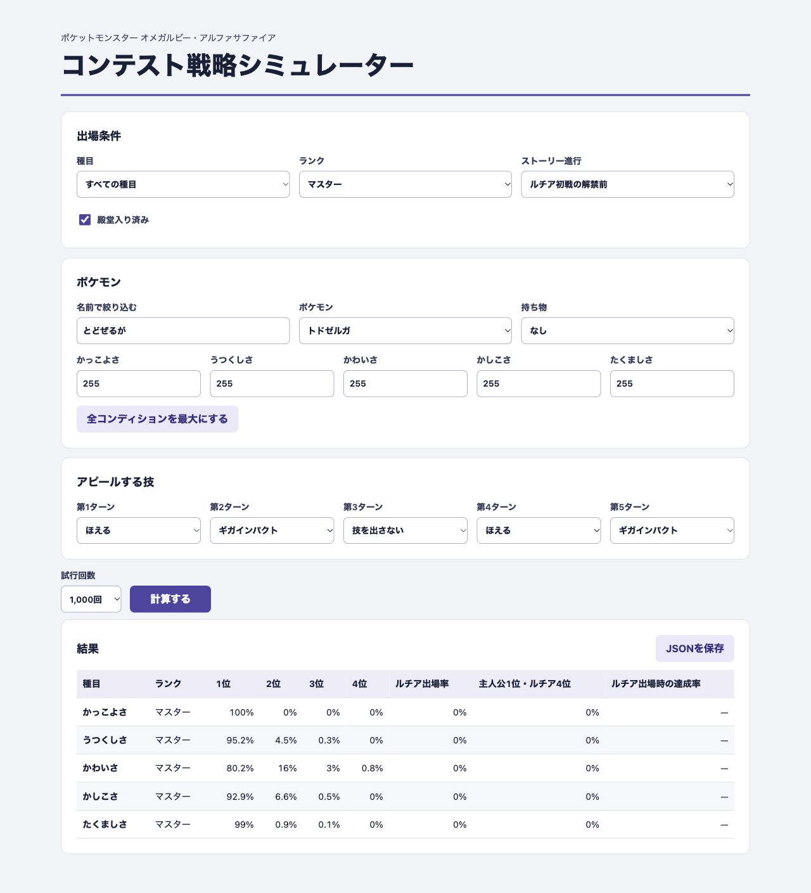

# ORAS コンテスト戦略シミュレーター

『ポケットモンスター オメガルビー・アルファサファイア』のコンテストライブを対象にした非公式ツールです。5種目 × 4ランクの全20部門について、指定したポケモンと技順での順位率や、主人公が1位かつルチアが4位になる確率を計算できます。

同じ計算エンジンを使う **ブラウザGUI版** と **Python CLI版** があります。どちらも Python 3.10 以降で動作し、ゲームROMやインターネット接続は不要です。

> **非公式プロジェクト**
> 任天堂株式会社、株式会社ポケモン、株式会社ゲームフリーク、株式会社クリーチャーズなどの関連企業は、開発・配布・運営に一切関与していません。各社の公認、提携、後援を受けていません。

## ブラウザGUI版

ZIPを展開し、macOSでは **Start ORAS.command**、Windowsでは **Start ORAS.bat** をダブルクリックします。既定のブラウザが開きます。開かない場合は、起動ウィンドウに表示されたURLを開いてください。起動ファイルを使えない場合は、展開先で `python3 -B -m oras_gui.server` を実行できます。終了は起動ウィンドウで Ctrl+C です。

1. **出場条件**で種目、ランク、ストーリー進行を選びます。「すべての種目」と「すべてのランク」で全20部門をまとめて計算できます。
2. **ポケモン**で名前を検索し、持ち物と5つのコンディションを設定します。一括で最大値にすることもできます。
3. **アピールする技**で第1〜第5ターンの技を選び、試行回数を指定して **計算する** を押します。反動などを想定した空欄は「技を出さない」を選びます。
4. **結果**で順位率とルチア関連の確率を確認します。達成率には全試行を分母にした値と、ルチアが出場した試行だけを分母にした値があります。**JSONを保存**で詳細を出力できます。



画像はルチア初戦の解禁前に、全コンディション最大のトドゼルガでマスター5種目を計算した例です。「技を出さない」は、行動可能だった場合でもそのターンを空欄として扱います。

## Python CLI版

リポジトリのルートで実行します。次の例はGUIの画面と同じ条件です。

```sh
python3 -B -m oras_contest simulate \
  --species walrein --conditions 255 255 255 255 255 \
  --turns roar giga-impact - roar giga-impact \
  --category all --rank master --npc cartridge \
  --contest-event-stage 15 --hall-of-fame --trials 1000 \
  --output results.json
```

`--rank all` に変更すると全20部門を計算します。`python3 -B -m oras_contest simulate --help` で全オプションを確認できます。

計算は抽選・技選択・採点のルールを再実装し、乱数分岐の独立性を仮定した推定です。データの出典、ライセンス、検証範囲は[計算エンジンのREADME](oras_contest/README.md)に記載しています。

[公開候補の再監査結果](docs/release-audit.md)

## ライセンス

本ツール独自のコードとドキュメントは、無料で利用・調査・改変・再配布できます。有償販売、ペイウォール、課金バンドルでの配布は禁止です。再配布時は元プロジェクトを明記し、ライセンスと権利表示を保持してください。改変を加えた場合はその旨を明示してください。第三者の資料には各資料の利用条件が適用されます。 [ライセンス全文](LICENSE) · [権利表示と第三者資料](NOTICE.md)
